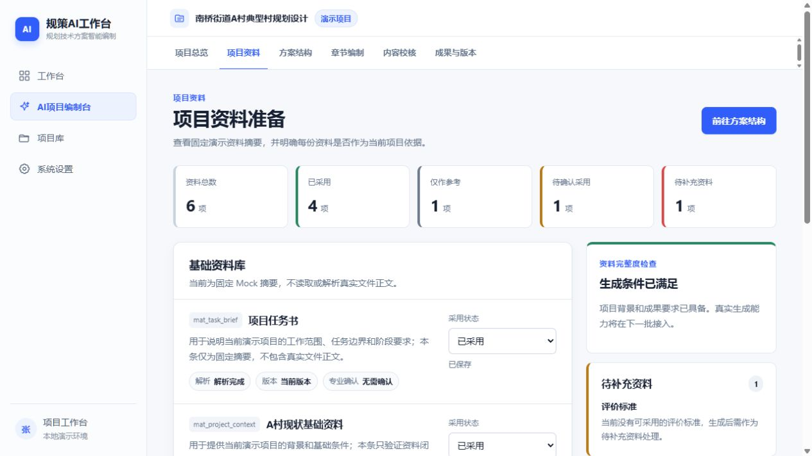

# 规划技术方案智能编制工作台

把规划方案编制拆成资料、目录、章节草稿、校核意见和人工确认。这个个人实验探索如何让 AI 建议、已确认内容与待复核状态在同一个工作台中衔接。

**个人实验 / Demo。** 当前公开版以代码实际实现为准，未附带生产运行效果证明。



截图来自公开副本的本地演示，显示模拟或测试数据。

## 能体验什么

- 项目建立与材料状态管理。
- Planner 目录建议、Writer 章节编制和 Reviewer 校核接口。
- 人工修改、问题处理和版本确认。
- 章节依赖与待复核标记。
- 成果汇总与已确认内容筛选，以及独立的展示页面；Word 导出尚未实现。

## 快速开始

建议使用 Node.js 22 LTS。在项目目录运行：

```sh
npm ci
npm run dev
```

浏览器打开 http://localhost:3000 。

如需外部服务，把 `.env.example` 复制为 `.env.local`，填写自己的配置，再重启。Key 必须留在服务端和本地环境文件中，不能提交。

无需 Key 可以浏览展示页面及本地项目界面。真实目录生成、编制和校核需要你自己的 DeepSeek Key，模型名称需以账户支持为准。运行状态保存到 `.local-data`；公开包不包含已有运行数据或历史模型回复。提示词文件位于 `docs/prompts`，它们也是运行时依赖。

## 演示顺序

先浏览 `/demo` 展示页；实际项目流程从 `/projects` 开始。展示页不代表真实模型执行。

## 当前边界

这是个人实验与产品机制演示，不代表前司生产系统源码。示例材料用于测试与展示，专业结论需人工判断。Planner/Writer/Reviewer 是不同职责的服务与提示词，并不意味着已实现多个自主 Agent。没有企业级登录、权限、部署或安全保障。

## 验证

```sh
npm run typecheck
npm test
```

默认单元测试使用测试数据。`test:*:smoke` 和 `test:case-001:planner` 为可选真实模型测试，会调用你的模型账户；普通使用不需要执行。

## 反馈与贡献

欢迎在 Issues 中提交使用场景、复现步骤和预期结果。请使用虚构或脱敏数据，不要提交密钥、客户文件或个人日记。改进文档、小范围修复和可复现的示例都欢迎。

如果这个项目对你有帮助，欢迎 Star，便于之后找到它。

## 许可

本项目采用 [MIT License](LICENSE)。第三方依赖遵循各自许可；服务端接口的使用也需遵循对应服务条款。
